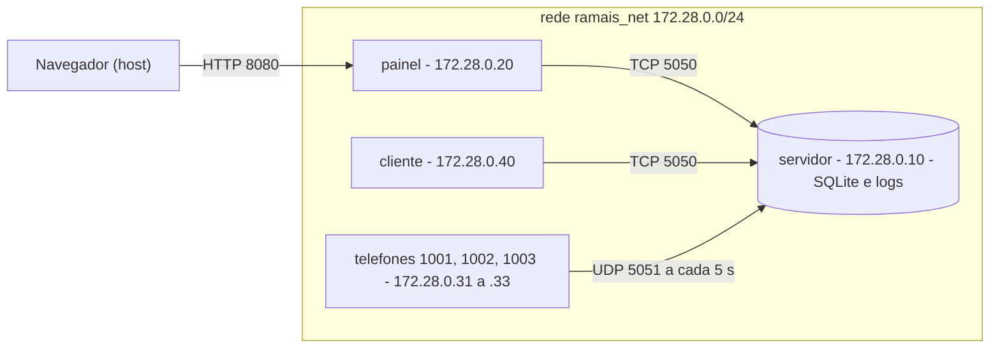

# Sistema de Ramais

> Projeto final de **PSI129A – Conectividade em Sistemas Ciberfísicos** · PUCPR · 2026/2

Um cadastro central dos ramais telefônicos de uma empresa. Pela rede interna é possível:

- **cadastrar, alterar, remover e buscar** ramais (número, nome e setor);
- ver **em tempo real** quais telefones estão ligados e com qual IP;
- separar quem **administra** (perfil `admin`) de quem **só consulta** (perfil `consulta`).

---

## Sumário

1. [Como executar](#como-executar)
2. [Arquitetura](#arquitetura)
3. [Por que TCP e UDP](#por-que-tcp-e-udp)
4. [Estrutura do código](#estrutura-do-código)
5. [Testes](#testes)
6. [Monitoramento e diagnóstico](#monitoramento-e-diagnóstico)
7. [Segurança](#segurança)
8. [Detalhes técnicos (protocolo e API)](#detalhes-técnicos)

---

## Como executar

**Requisito:** Docker Desktop (ou Docker Engine com o plugin Compose).

**1. Crie o arquivo de senhas** a partir do exemplo e troque as senhas dentro dele:

```bash
cp .env.exemplo .env
```

**2. Suba o ambiente:**

```bash
docker compose up -d --build
```

**3. Abra o painel** em <http://localhost:8080> e entre com o usuário `admin` (ou `consulta`) e a senha que você colocou no `.env`.

**4. (Opcional) Use o cliente de terminal**, que fala TCP direto com o servidor:

```bash
docker compose run --rm cliente
```

**Para parar tudo:**

```bash
docker compose down        # mantém o banco
docker compose down -v     # apaga também o banco
```

<details>
<summary><b>Rodar sem Docker (para desenvolver)</b></summary>

<br>

Só precisa de Python 3.10+. O projeto usa apenas a biblioteca padrão.
Abra três terminais na pasta do projeto (exemplo em PowerShell):

```powershell
$env:ADMIN_SENHA="..."; $env:CONSULTA_SENHA="..."; python -m ramais.servidor
```

```powershell
python -m ramais.painel
```

```powershell
$env:RAMAL="1001"; python -m ramais.telefone
```

</details>

---

## Arquitetura

Seis contêineres na rede Docker `ramais_net` (`172.28.0.0/24`, gateway `172.28.0.1`):



| Nó | IP | Porta | Função |
|---|---|---|---|
| **servidor** | 172.28.0.10 | 5050/TCP e 5051/UDP | Guarda os ramais, faz login e recebe o aviso dos telefones |
| **painel** | 172.28.0.20 | 8080/TCP (HTTP) | Site aberto no navegador; repassa os pedidos ao servidor |
| **telefone-1001 a 1003** | 172.28.0.31 a .33 | — | Simulam aparelhos avisando "estou ligado" |
| **cliente** | 172.28.0.40 | — | Menu de administração no terminal |

**Fluxo:** o navegador fala **HTTP** com o painel → o painel fala **TCP** com o servidor → os telefones mandam **UDP** direto ao servidor.

---

## Por que TCP e UDP

| Onde | Transporte | Motivo |
|---|---|---|
| Cadastro de ramais | **TCP** | Um cadastro não pode se perder, duplicar nem chegar fora de ordem. |
| Aviso dos telefones | **UDP** | Mensagem minúscula repetida a cada 5 s: se uma se perde, a próxima resolve, sem manter uma conexão aberta por telefone. |
| Painel | **HTTP** | Protocolo padrão: qualquer navegador vira cliente, sem instalar nada. |

Um ramal aparece **online** se o servidor recebeu o aviso dele nos últimos **15 s**.

---

## Estrutura do código

| Arquivo | O que faz |
|---|---|
| `ramais/servidor.py` | Servidor TCP com uma thread por cliente, escuta UDP e banco SQLite |
| `ramais/protocolo.py` | Lado cliente do protocolo, com timeout e reconexão |
| `ramais/painel.py` e `painel.html` | Servidor HTTP e a página web |
| `ramais/cliente.py` | Cliente interativo de terminal |
| `ramais/telefone.py` | Simulador de telefone |
| `testes/teste_carga.py` | Vários clientes ao mesmo tempo, mede o tempo de resposta |
| `scripts/diagnostico.sh` | Diagnóstico do Linux dentro de um contêiner |
| `docs/` | Documento-resumo e roteiro do vídeo |

---

## Testes

**Concorrência** — 10 clientes simultâneos, 20 pedidos cada (pede a senha do usuário `consulta`):

```bash
docker compose run --rm cliente python -m testes.teste_carga --clientes 10
```

**Servidor fora do ar** — o painel mostra um aviso e o cliente tenta reconectar:

```bash
docker compose stop servidor
docker compose start servidor
```

**Telefone desligado** — o ramal 1002 fica offline no painel em até 15 s:

```bash
docker compose stop telefone-1002
```

---

## Monitoramento e diagnóstico

**Estado dos contêineres e logs:**

```bash
docker compose ps
docker compose logs -f servidor
```

**`ip`, `ss`, `dig`, `ping`, `traceroute`, `ps` e `top` de uma vez:**

```bash
docker compose exec servidor sh scripts/diagnostico.sh
```

**Captura de tráfego** (precisa de root dentro do contêiner):

```bash
docker compose exec -u root servidor tcpdump -i eth0 -n -A -c 20 "port 5050 or port 5051"
```

---

## Segurança

- **Login e perfis:** `admin` altera, `consulta` só lê. Senhas guardadas como hash PBKDF2-SHA256 com sal; sessão expira em 1 h.
- **Sem root:** os processos rodam como o usuário `ramais`; banco e logs só podem ser lidos por ele.
- **Pouca exposição:** só a porta 8080 do painel é aberta para fora; o servidor só é alcançável de dentro da rede Docker.
- **Validação de entrada:** formato do número, tamanho dos campos e do pedido; SQL parametrizado; a página não usa `innerHTML` (evita XSS).

> ⚠️ **Limitações conhecidas:** o tráfego não é cifrado (sem TLS) e o aviso UDP dos telefones não é autenticado. Aceitável em rede interna de laboratório; listado como trabalho futuro.

---

## Detalhes técnicos

<details>
<summary><b>Protocolo próprio sobre TCP (porta 5050)</b></summary>

<br>

Uma mensagem JSON por linha, em UTF-8, com no máximo 4096 bytes por pedido.

```text
-> {"acao": "login", "usuario": "admin", "senha": "..."}
<- {"ok": true, "dados": {"token": "9f3c...", "usuario": "admin", "perfil": "admin"}}

-> {"acao": "criar", "token": "9f3c...", "numero": "1005", "nome": "Joao", "setor": "RH"}
<- {"ok": true, "dados": {"numero": "1005", "nome": "Joao", "setor": "RH"}}

-> {"acao": "criar", "token": "9f3c...", "numero": "1005", "nome": "Outro", "setor": "RH"}
<- {"ok": false, "codigo": "conflito", "erro": "o ramal 1005 ja existe"}
```

| Ação | Quem pode | Campos |
|---|---|---|
| `login` | todos | `usuario`, `senha` |
| `listar` | qualquer perfil | `filtro` (opcional) |
| `criar` | admin | `numero`, `nome`, `setor` |
| `atualizar` | admin | `numero`, `novo_numero` (opcional), `nome`, `setor` |
| `remover` | admin | `numero` |
| `estado` | qualquer perfil | — |
| `sair` | qualquer perfil | — |

**Códigos de erro:** `invalido`, `nao_autenticado`, `proibido`, `nao_encontrado`, `conflito`, `erro_interno`.

</details>

<details>
<summary><b>Aviso dos telefones sobre UDP (porta 5051)</b></summary>

<br>

Cada telefone envia o datagrama `{"ramal": "1001"}` a cada 5 s. O servidor não responde.

</details>

<details>
<summary><b>API HTTP do painel (porta 8080)</b></summary>

<br>

| Método e rota | O que faz |
|---|---|
| `POST /api/login` | Login; devolve cookie de sessão `HttpOnly` |
| `POST /api/logout` | Encerra a sessão |
| `GET /api/ramais?filtro=` | Lista ou busca ramais |
| `POST /api/ramais` | Cria um ramal |
| `PUT /api/ramais/<numero>` | Altera um ramal |
| `DELETE /api/ramais/<numero>` | Remove um ramal |
| `GET /api/estado` | Números do servidor (threads, conexões, ramais online) |

</details>
